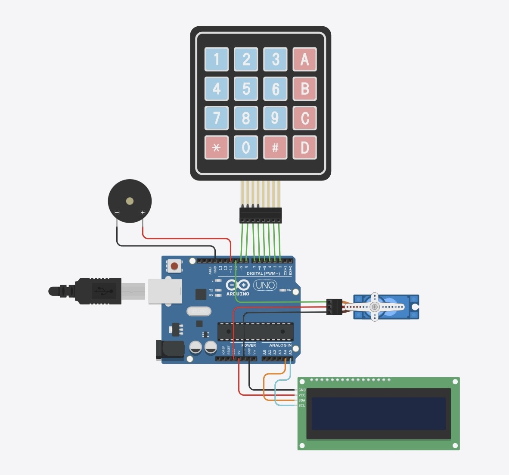

# 🚪🔐 Arduino Door Lock System

> Interactive Tinkercad simulation and C++ source code for a secure electronic door lock featuring a $4 \times 4$ matrix keypad, I2C LCD display, servo motor, and buzzer.

## 📌 Circuit Overview

🔗 **Test the live simulation:** 

## 🚀 Features
- **Custom Password Engine:** Securely handles input matching, evaluation, and dynamic key appends using overloaded operators (`<<`).
- **Keypad Interface:** Integrates a $4 \times 4$ matrix keypad for entering passwords and controlling system states.
- **LCD Feedback (I2C):** Displays real-time status updates, prompts ("ENTER PASSWORD", "DOOR OPENED"), and masked character entry (`*`).
- **Servo Motor Actuation:** Simulates physical latch movement for locked and unlocked states.
- **Audio Alerts:** Uses an active buzzer to signal successful entries or incorrect code attempts.

## 🛠️ Components Used
- 1x Arduino Uno
- 1x $4 \times 4$ Matrix Keypad
- 1x 16x2 LCD Display with I2C Module
- 1x Servo Motor
- 1x Piezo Buzzer
- Breadboard and jumper wires

## 📂 Repository Structure
- `DoorLockSystem.ino` : The main C++ source code for the Arduino.
- `tinkercard-door-locked-system.png` : Screenshot of the Tinkercad wiring diagram.
